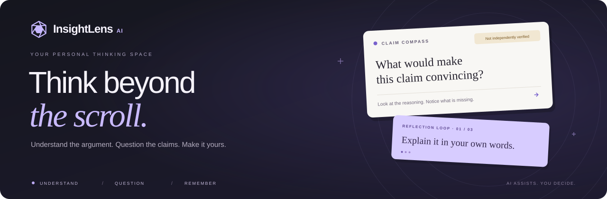

<div align="center">

<a href="https://insightlens-ai-flame.vercel.app">
  
</a>

# InsightLens AI

### Think Beyond the Scroll.

Turn what you read into something you understand.

Explore the argument. Question the claims. Make the insight your own.

[](https://nextjs.org/)
[](https://www.typescriptlang.org/)
[](https://supabase.com/)
[](https://vercel.com/)

**[🚀 Open the App](https://insightlens-ai-flame.vercel.app)** &nbsp;·&nbsp; **[✨ Explore the Demo](https://insightlens-ai-flame.vercel.app/analyze?demo=1)** &nbsp;·&nbsp; **[📚 Read the Docs](#-documentation)**

<sub>A calm workspace for curious minds. No endless feed. Just your next good question.</sub>

</div>

---

## 🌱 A thinking space for curious minds

Information is easy to consume. Understanding takes a little more attention.

**InsightLens AI** turns articles, essays, and transcripts into a guided learning experience: a clear overview, categorized claims, three reflection questions, and one meaningful next step. A calm reading workspace helps you slow down and engage with the ideas that matter.

> [!TIP]
> **Start with curiosity, not a sign-up form.** [Explore the sample demo](https://insightlens-ai-flame.vercel.app/analyze?demo=1) without an account or API key. Its original essay and prewritten results are clearly labeled. Live AI needs Gemini configuration; accounts, private saving, and production usage controls need Supabase.

<p align="center">
  <a href="#-what-you-can-do">Features</a> &nbsp;·&nbsp;
  <a href="#-built-with">Tech stack</a> &nbsp;·&nbsp;
  <a href="#-run-locally">Quick start</a> &nbsp;·&nbsp;
  <a href="#-connect-your-services">Configuration</a> &nbsp;·&nbsp;
  <a href="#-quality-checks">Testing</a>
</p>

## ✨ What you can do

<table>
  <tr>
    <td width="50%" valign="top">
      <h3>🧭 Find your perspective</h3>
      <p>Follow the main argument, open a claim, and look for the evidence that would help you decide.</p>
    </td>
    <td width="50%" valign="top">
      <h3>💭 Make the idea yours</h3>
      <p>Answer a thoughtful question in your own words. Explore an assumption. Try a practical application.</p>
    </td>
  </tr>
  <tr>
    <td width="50%" valign="top">
      <h3>📖 Give your reading room</h3>
      <p>Step into Focus Mode and choose a reading surface, type style, and pace that feel comfortable.</p>
    </td>
    <td width="50%" valign="top">
      <h3>🌿 Keep what matters</h3>
      <p>Record a takeaway, export your notes, or explicitly save an analysis to your configured private library.</p>
    </td>
  </tr>
</table>

| Feature                   | Experience                                                                                     |
| ------------------------- | ---------------------------------------------------------------------------------------------- |
| 📄 **Content analysis**   | Explore pasted text, supplied transcripts, and supported public article URLs.                  |
| 💡 **Main ideas**         | Find the central argument, important concepts, caveats, and unresolved questions.              |
| 🧭 **Claim Compass**      | Expand categorized claims to inspect source excerpts, reasoning, and missing evidence.         |
| 💭 **Reflection Loop**    | Work through understanding, critical-thinking, and application questions at your own pace.     |
| 📖 **Focus Reading View** | Hide navigation and adjust typography, reading width, spacing, and surface.                    |
| 🧾 **Attention Receipt**  | Review actual claim-card interactions, written reflections, and your own takeaway.             |
| 📚 **Knowledge library**  | With configured authentication, explicitly save, search, filter, revisit, and delete analyses. |
| 🎨 **Personalization**    | Choose Light, Dark, or System appearance, four accent palettes, and learning preferences.      |
| 📥 **Take it with you**   | Copy insights or export an analysis and its reflections as Markdown.                           |

<div align="center">

**📄 Add content &nbsp;→&nbsp; 💡 Understand &nbsp;→&nbsp; 🧭 Examine &nbsp;→&nbsp; 💭 Reflect &nbsp;→&nbsp; 🌱 Apply**

<sub>One source. A few better questions. Something worth remembering.</sub>

</div>

## 🛡️ Evidence before confidence

An AI summary is an interpretation. A statement in an article is not proof of that statement.

This release **does not retrieve independent evidence**. Claims remain **Not independently verified**, and the interface distinguishes source excerpts from external verification. It does not assign intelligence scores or promise improvements in attention or memory.

## 🛠️ Built with

| Layer             | Technology                                                                 |
| ----------------- | -------------------------------------------------------------------------- |
| Application       | Next.js App Router, React, strict TypeScript                               |
| Interface         | Tailwind CSS, Radix UI, source-owned shadcn-style components, Lucide icons |
| Interaction       | Motion, next-themes, React Hook Form, Recharts                             |
| AI                | Gemini through the Vercel AI SDK, with Zod-validated structured output     |
| Accounts and data | Supabase Auth, PostgreSQL, Row Level Security                              |
| Quality           | Vitest, Playwright, axe accessibility checks                               |
| Hosting           | Vercel with GitHub integration                                             |

## ⚡ Run locally

Use **Node.js 22.12 or later** and npm. Local verification used Node.js 24.

```powershell
git clone https://github.com/harshitCorteX/insightlens-ai.git
cd insightlens-ai
npm ci
Copy-Item .env.example .env.local
npm run dev
```

Open **[http://127.0.0.1:3000](http://127.0.0.1:3000)** and select **Explore demo**.

The sample works without credentials. Live requests never silently fall back to sample results.

> **Windows tip:** Keep your checkout outside OneDrive, for example in `C:\Projects\insightlens-ai`, so temporary build files do not trigger sync and deletion prompts.

## 🔌 Connect your services

Use [`.env.example`](.env.example) as the configuration reference. Put local values in `.env.local`; configure deployed values directly in Vercel.

| Variable                               | Purpose                                                               | Visibility  |
| -------------------------------------- | --------------------------------------------------------------------- | ----------- |
| `NEXT_PUBLIC_APP_URL`                  | Exact app origin: local URL for development, HTTPS URL for deployment | Public      |
| `NEXT_PUBLIC_SUPABASE_URL`             | Supabase project URL                                                  | Public      |
| `NEXT_PUBLIC_SUPABASE_PUBLISHABLE_KEY` | Supabase publishable key                                              | Public      |
| `SUPABASE_SERVICE_ROLE_KEY`            | Production quotas and account deletion                                | Server only |
| `RATE_LIMIT_SECRET`                    | Secret for hashing quota subjects                                     | Server only |
| `AI_PROVIDER`                          | Set to `gemini`                                                       | Server only |
| `GEMINI_API_KEY`                       | Your Gemini API credential                                            | Server only |
| `GEMINI_MODEL`                         | A supported model available to your account                           | Server only |

<details>
<summary><strong>🤖 Set up Gemini — enable live analysis</strong></summary>

1. Create an API key in [Google AI Studio](https://aistudio.google.com/apikey).
2. Set `AI_PROVIDER=gemini`, `GEMINI_API_KEY`, and `GEMINI_MODEL` in `.env.local`.
3. Restart the development server and submit 100–30,000 characters of permitted text.
4. Configure the same values in Vercel for hosted live analysis.

Analysis and reflection feedback run on the server. Review your provider account’s model availability, pricing, and data-use settings before enabling live requests.

</details>

<details>
<summary><strong>🗄️ Set up Supabase — accounts, library, and quotas</strong></summary>

1. Create a project in [Supabase](https://supabase.com/dashboard).
2. Add its project URL and publishable key to your environment.
3. Run the [database migration](supabase/migrations/202611020001_initial.sql) in the SQL Editor, or apply it through the Supabase CLI.
4. Enable email/password authentication and configure email confirmation and delivery.
5. Set the Auth Site URL to your app origin. Allow the exact `/auth/callback` URL for each environment you use.
6. Add the private service-role key for production quotas and account deletion.

**Production live AI also needs Supabase:** shared usage limits use its quota function. Normal saved-analysis access uses the authenticated user’s session and RLS.

See [Database](docs/DATABASE.md) for ownership policies and [Testing](docs/TESTING.md) for the optional two-user isolation test.

</details>

Never commit `.env.local` or give server-only keys a `NEXT_PUBLIC_` prefix.

## 🚀 Deploy on Vercel

1. Push your repository to GitHub and import it at [Vercel](https://vercel.com/new).
2. Select **Next.js**, use the repository root, and keep the Output Directory override disabled.
3. Use `npm ci` to install and `npm run build` to build.
4. Add the required environment variables. Set `NEXT_PUBLIC_APP_URL` to the exact deployed HTTPS origin.
5. Apply the Supabase migration and configure the matching Auth callback URL.
6. Deploy, then test analysis, reflection, authentication, saving, and deletion with your real service configuration.

Generate a private rate-limit secret locally:

```powershell
node -e "console.log(require('node:crypto').randomBytes(32).toString('hex'))"
```

Vercel builds use `.next`; local builds use `.next-build` for the Windows cache workaround. Production AI requests fail closed if the shared quota configuration is missing.

For the full setup, preview checks, and public-launch requirements, see the [deployment guide](docs/DEPLOYMENT.md).

## 🧪 Quality checks

```powershell
npm run typecheck
npm test
npm run build
npx playwright install chromium
npm run test:e2e
```

The recorded local verification on **2 November 2026** included:

- **59 passing unit/integration tests** covering validation, provider failures, ownership filters, persistence contracts, SSRF protection, and usage controls.
- **9 passing Chromium browser tests** covering desktop/mobile journeys, Focus Mode, theme persistence, exports, and library service fixtures.
- Layout checks at **375, 430, 768, 1024, 1280, and 1440px**.
- Automated axe checks on representative light/dark pages and the focused reading surface.

The real Supabase RLS test was skipped without credentials; a duplicate mobile viewport sweep was intentionally skipped. Deterministic tests do not establish real-provider quality, email delivery, or deployed database isolation.

See the [verification record](docs/VERIFICATION.md) for the original test run and the [testing guide](docs/TESTING.md) to reproduce it.

## 📚 Documentation

| Guide                                  | What it covers                                            |
| -------------------------------------- | --------------------------------------------------------- |
| [Architecture](docs/ARCHITECTURE.md)   | Application boundaries, data flow, and security decisions |
| [Features](docs/FEATURES.md)           | Routes, product behavior, and current scope               |
| [Database](docs/DATABASE.md)           | Schema, ownership, RLS, deletion, and retention           |
| [AI pipeline](docs/AI_PIPELINE.md)     | Structured output, prompts, quotas, and limitations       |
| [Design system](docs/DESIGN_SYSTEM.md) | Typography, tokens, themes, and accessibility             |
| [Deployment](docs/DEPLOYMENT.md)       | Gemini, Supabase, GitHub, and Vercel setup                |
| [Testing](docs/TESTING.md)             | Automated checks and external release checks              |

## 🗺️ Current scope

- Article extraction is best effort on six supported hosts. Restricted pages need pasted text; YouTube needs a supplied transcript.
- Guest analyses and answers use the current tab’s session storage. Explicit account saving is required for a durable library copy.
- The library loads the latest 200 saved analyses; search and filters apply to those records.
- Independent evidence retrieval, automatic captions, OAuth, multilingual UI, persistent highlights, reminders, knowledge graphs, and PDF export are not included.
- Provider credentials, email delivery, database policies, and billing limits must be configured and verified for each deployment. Complete the operator/contact disclosures before public launch.

---

<div align="center">

**A little less consumption. A little more understanding.**

Made with curiosity by [harshitCorteX](https://github.com/harshitCorteX) 💜

**[✨ Find your next moment of clarity](https://insightlens-ai-flame.vercel.app)**

</div>
